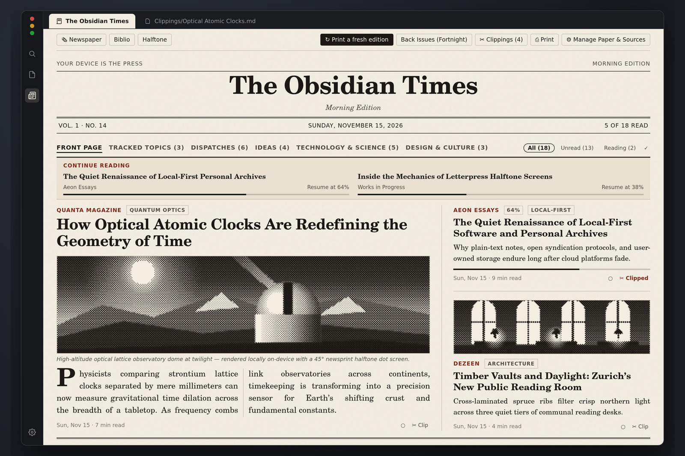

# Obsidian Press (`obsidian-press`)

**Obsidian Press** turns your subscribed RSS, Atom, and JSON feeds into a personal, local-first morning newspaper or magazine directly inside Obsidian — inspired by [Biblio Times](https://biblio.ink/times).

**Your device is the press:** feeds are fetched, parsed, typeset, and archived locally using Obsidian's native `requestUrl` API with zero accounts, zero intermediary proxy servers, and zero tracking.



---

## Features

- **Editorial Editions (Newspaper Format)**
  - **Biblio:** *Fraunces* display headlines & classic book serif typography on warm newsprint (`#f3ede2`).
  - **Digital:** Crisp grotesque typography in a clean Swiss grid.
  - **Dystopian:** Grey pulp stock paired with monospace typewriter headlines and decks.
- **Magazine Formats & Weekday Schedule**
  - **Bicycle:** Literary serif magazine on warm cream stock.
  - **Signal:** Bold grotesque magazine on cool grey with numbered block cards.
  - **Plate:** Photography-led magazine on crisp white or deep black stock.
  - Configure automatic magazine days (e.g., Sunday Magazine by default) or toggle formats on the fly.
- **True 45° `<canvas>` Halftone Photography**
  - Converts article photography into authentic 45° newsprint halftone dot screens on your device (CORS-free via `requestUrl`), or switch between *Muted Color Ink*, *Full Color*, and *No Pictures*.
- **In-Paper Reader & Full-Text Extraction**
  - Automatically fetches and extracts full article text on open (configurable) with a 1-click toggle back to the feed summary.
  - Displays a clean status banner for publishers behind HTTP `401`/`403`/`429` consent or bot walls, offering a desktop embedded `<webview>` view or external browser launch.
  - Tracks reading progress down to the paragraph index and automatically scrolls back to where you left off.
- **Conflict-Free Cross-Device Sync (Obsidian Sync Compatible)**
  - Maintains a line-oriented Markdown ledger (`obsidian-press-sync.md` by default, configurable path in the vault) so Obsidian Sync merges concurrent edits line-by-line across desktop and mobile without requiring Community Plugin Sync.
  - Synchronizes subscribed feeds, papers, editorial desks, clipped article index, read/unread status, and paragraph-accurate reading progress.
- **Vault Clippings & 14-Day Back-Issue Archive**
  - Clip full stories or highlighted selections into your vault (`Clippings/` by default) as clean Markdown notes with Obsidian Web Clipper-compatible YAML frontmatter (`title`, `source`, `author`, `published`, `created`, `description`, `publication`, `tags: ["clippings"]`).
  - Keeps daily snapshots locally in the *Fortnight Rack* (default: 14 days) so you can browse past editions anytime, plus clean print/PDF output for full editions or individual articles.
- **Sources, Starter Desks & Filtering**
  - Includes optional curated starter publications (*DACH*, *UK & Europe*, *US & Global*, *Ideas*, *Design*, *Technology*), HTML feed autodiscovery from ordinary website URLs, automatic *Correspondence* desk for unassigned feeds, OPML import/export, *Tracked Topics*, *Muted Keywords*, multiple configurable papers, and English (default) / German UI localization.

---

## Installation

### Option 1: Using BRAT (Beta Reviewers Auto-update Tester)
1. Install and enable the **BRAT** community plugin in Obsidian.
2. Open **Settings -> BRAT -> Add Beta plugin**.
3. Enter the repository URL: `https://github.com/MarkusLitz/obsidian-press`.
4. Enable **Obsidian Press** under **Settings -> Community plugins**.

### Option 2: Manual Installation from Releases
1. Download `main.js`, `manifest.json`, and `styles.css` from the latest GitHub Release.
2. Create `<YourVault>/.obsidian/plugins/obsidian-press/` and copy those three files into it.
3. Reload community plugins in Obsidian and enable **Obsidian Press**.

### Option 3: Build from Source
```bash
git clone https://github.com/MarkusLitz/obsidian-press.git .obsidian/plugins/obsidian-press
cd .obsidian/plugins/obsidian-press
npm install
npm run build
```

---

## Usage & Commands

- **Open Morning Edition** (or click the newspaper ribbon icon): Opens today's edition or builds it from your configured feeds.
- **Print a Fresh Edition**: Re-fetches all enabled feeds and compiles a fresh issue snapshot.
- **Manage Press Room, Sources & Starter Desks**: Opens the editorial studio modal to add/remove feeds, import/export OPML, arrange desks, switch editions, or configure Tracked Topics & Muted Keywords.
- **Sync Sources, Desks & Reading Progress Now**: Forces an immediate read-merge-write pass against your vault sync ledger.

Nothing is pre-selected on first launch — add feeds directly by pasting any website or RSS/Atom/JSON URL, picking from the Starter Desks, or importing an OPML file.

---

## Privacy & Network Disclosure

In accordance with Obsidian's plugin guidelines:
- **No accounts, telemetry, analytics, or intermediary servers.**
- **Feed & article fetches:** `requestUrl` connects directly from your device only to the feed URLs and article URLs you subscribe to or open.
- **Embedded web view fallback:** Only loaded interactively on desktop if you click *"Open in embedded web view"* when a publisher blocks background extraction.
- **Editorial typography (optional):** When *"Load Editorial Webfonts"* is enabled in settings, the plugin loads a Google Fonts stylesheet (`Fraunces`, `Newsreader`, `Inter`, `Courier Prime`). Disabling this option switches cleanly to local system serif/sans/monospace fallbacks with zero external font requests.
- **Vault files written:** Clipped notes in your configured clippings folder (`Clippings/`), the cross-device sync ledger (`obsidian-press-sync.md` or your configured vault path) when enabled, and local daily issue JSON caches inside `.obsidian/plugins/obsidian-press/editions/`.

---

## Development & Tests

```bash
npm install
npm run build
npm test
```

If `npm` is unavailable in a restricted environment, run the bundled toolchain directly:

```bash
./node_modules/.bin/tsc -noEmit -skipLibCheck && node esbuild.config.mjs production
node --test test/*.test.mjs
```

---

## License

MIT License — see [LICENSE](LICENSE) for details.
